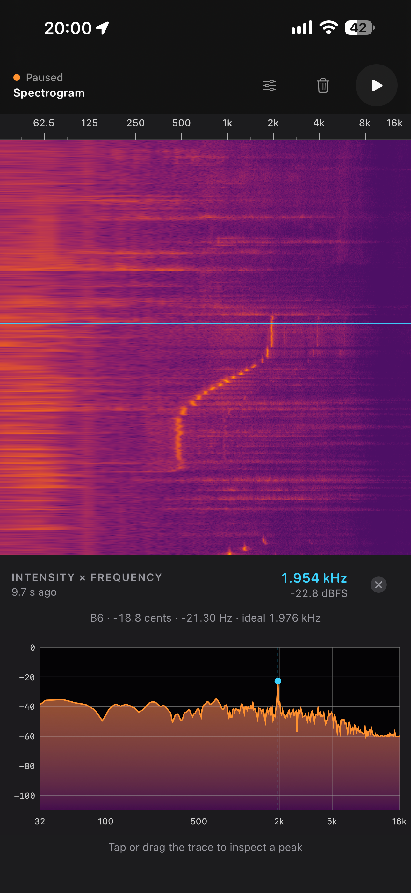

# Simple Spectrogram for iOS

A focused real-time microphone spectrogram for iPhone and iPad. It uses a logarithmic frequency axis and the Inferno color map by default, with no network access or third-party runtime dependencies.

[Download on the App Store](https://apps.apple.com/us/app/simple-spectrogram/id6823407210)



## Using the app

- Tap pause/play to freeze or resume the waterfall. Resuming closes the selected slice.
- Tap any horizontal slice to freeze it and open its intensity-versus-frequency trace.
- The strongest frequency is labeled automatically. Tap or drag anywhere on the trace to snap the label to the nearest local peak. With VoiceOver, adjust the plot to step between peaks.
- Tap the trash button to clear captured history.
- Open the sliders button to adjust the frequency range, display noise floor, and contrast. The default range is 32 Hz–16 kHz, with room below the 50 Hz mains band. Display settings persist across launches.
- Selected peaks show the nearest equal-tempered musical note (A4 = 440 Hz), the ideal note frequency, and the difference in cents and hertz. These are notes for individual spectral peaks, which may be harmonics rather than the sound’s fundamental.

Microphone samples are analyzed in memory and are never recorded or transmitted.

## Architecture

`AVAudioEngine` captures 48 kHz floating-point audio. A bounded preallocated ring buffer moves samples off the real-time callback, and Accelerate performs a 4,096-point Hann-windowed FFT every 1,024 samples. A fixed 1,024-row viewport shows roughly 22 seconds at 48 kHz. History retains another 256 rows outside the viewport so delayed presentation and interpolation never discard a row while it is still visible.

Metal batches new spectra into command-buffer texture uploads. During capture, a buffered fractional playhead scrolls at the display refresh rate, requesting up to 120 Hz on ProMotion screens. About 1.5 audio hops (32 ms at 48 kHz) of presentation buffering absorb chunk-delivery jitter. Paused rendering is event-driven. Newest audio enters at the top without a fade; older audio scrolls down past the bottom screen edge before being discarded, without a fade. A separate frequency ruler above the waterfall has logarithmic major ticks every octave, anchored at 1 kHz, with no grid lines drawn over the measured spectra. Each spectrum occupies a single 8-bit texture row. Its fragment shader performs the logarithmic frequency lookup and Inferno color mapping, so the CPU does not redraw the waterfall. The time scale stays fixed while history fills, and uncaptured time stays blank. Inferno uses a configurable dB window and contrast curve to separate signals from background noise; stored dBFS measurements are unchanged. SwiftUI supplies controls, grid labels, accessibility, and the interactive spectrum trace.

## Building

Requirements: Xcode 26 or later and XcodeGen. CI uses Xcode 26.3.

```sh
brew install xcodegen
xcodegen generate
open Spectrogram.xcodeproj
```

The app supports iOS 16 and later. Core frequency mapping, history, and peak interpolation also form a Swift package and can be tested with `swift test` on platforms with Swift 5.9 or later.
